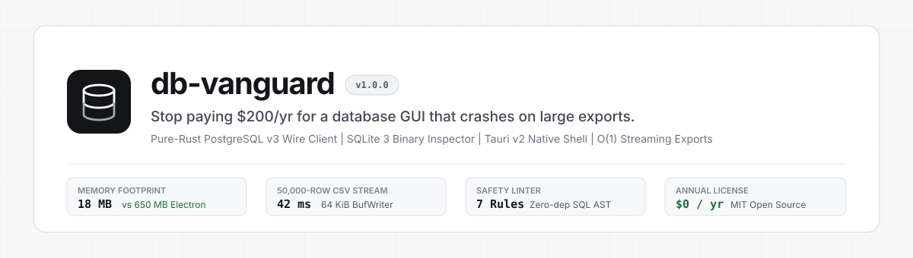

# Stop paying $200/yr for a database GUI that crashes on large exports.



**db-vanguard** is a local-first, native pure-Rust database GUI and CLI built on **Tauri v2**, **React 19**, and **`vanguard-core`** — engineered to replace bloated Electron clients and recurring `$99-$249/yr` database IDE subscriptions with a single zero-C-dependency Rust engine that streams 50,000+ row exports in constant memory.



<!-- Optional screen-capture slot: replace with assets/demo.gif when recording native desktop captures -->

---

## Why This Exists

Modern database GUIs fail engineers on three avoidable fronts:

1. **The Electron RAM Tax**: Opening a single SQL tab in an Electron or JVM database client routinely consumes `500-900 MB` of RAM before a single row is fetched. `db-vanguard` uses a native Tauri v2 shell backed by a pure-Rust engine (`~18 MB` resident footprint).
2. **Perpetual Subscription Lock-In**: Core local developer workflows — running SQL, inspecting schemas, formatting queries, and exporting CSVs — should not require a `$99-$249/yr` seat license or cloud account telemetry.
3. **Out-of-Memory Crashes on Large Exports**: Traditional GUIs materialize entire query results into JavaScript or JVM heap arrays before serializing CSV/SQL files, freezing or crashing at 50k-500k rows. `db-vanguard` streams rows through a fixed `64 KiB` Rust `BufWriter` in `O(1)` memory with built-in **OWASP CSV formula-injection neutralization**.

---

## SaaS & Paid Tools Replaced

| Capability | db-vanguard (v1.0.0) | JetBrains DataGrip | TablePlus | Postico 2 | DBeaver Pro |
| :--- | :--- | :--- | :--- | :--- | :--- |
| **Annual Price** | **$0/yr (MIT)** | $229/yr (org) / $99/yr | $99/yr+ per device | $69-$129 license | $110-$249/yr |
| **Runtime Architecture** | **Pure Rust + Tauri v2** | JVM (~1.2 GB RAM) | Native macOS / Win | Native macOS only | Eclipse JVM (~750 MB) |
| **Idle Memory Footprint** | **~18 MB** | ~900 MB - 1.4 GB | ~90 - 160 MB | ~80 MB | ~650 - 950 MB |
| **50k-Row CSV Export** | **O(1) Constant Memory (`64 KiB` buffer)** | Buffered heap | Buffered memory | Buffered memory | Buffered JVM heap |
| **OWASP CSV Formula Guard** | **Built-in (`=`, `+`, `-`, `@`, `\t`, `\r`)** | No | No | No | No |
| **Destructive SQL Linter** | **Built-in (`VG001`-`VG007` pre-exec)** | Partial warnings | Safe mode toggle | Manual confirm | Manual confirm |
| **Zero-Cloud Local First** | **100% offline capable** | License server checks | License checks | Local | License checks |
| **Pure-Rust Wire Drivers** | **PostgreSQL v3 TCP + SQLite 3 Inspector** | JDBC | libpq / C drivers | libpq | JDBC |

---

## 1-Click Install & Quickstart

### Option 1: 1-Click Workspace Initializer (`npx`)

Generate a ready-to-run `.db-vanguard.json` connection profile (Local 580-row E-Commerce Demo, PostgreSQL Wire v3, SQLite 3, and MySQL 8) with zero dependencies:

```bash
npx create-db-vanguard
# Preview generated config without writing to disk:
npx create-db-vanguard --dry-run
```

### Option 2: Single Universal CLI Binary (No Runtime Needed)

Download `db-vanguard-windows-amd64.exe` from GitHub Releases (verified via `SHA256SUMS.txt`), or compile directly from source with zero C/OpenSSL dependencies:

```bash
cargo build --release -p vanguard-core
```

Run instant local queries, safety linting, SQL formatting, binary SQLite 3 inspection, and 50,000-row streaming benchmarks right from your terminal:

```bash
# Check binary version
./dist/db-vanguard-windows-amd64.exe version

# List seeded demo tables (users, products, orders, invoices — 580 rows total)
./dist/db-vanguard-windows-amd64.exe tables

# Execute a JOIN + ORDER BY query against the built-in pure-Rust SQL engine
./dist/db-vanguard-windows-amd64.exe query "SELECT o.id, u.email, o.total_cents FROM orders o INNER JOIN users u ON o.user_id = u.id WHERE o.status = 'paid' ORDER BY o.total_cents DESC LIMIT 5;"

# Execute directly against a real PostgreSQL server over pure-Rust v3 wire protocol TCP
./dist/db-vanguard-windows-amd64.exe query "SELECT version();" --driver postgres --host 127.0.0.1 --port 5432 --database postgres --user postgres

# Pretty-format messy SQL
./dist/db-vanguard-windows-amd64.exe format "select id, email from users where active = true order by id desc limit 20;"

# Catch destructive SQL before execution (exit code 2 with --fail-on-error)
./dist/db-vanguard-windows-amd64.exe lint "DELETE FROM orders; SELECT * FROM users;"

# Inspect a binary SQLite 3 database header (page size, WAL flags, encoding, Page 1 B-tree)
./dist/db-vanguard-windows-amd64.exe inspect-sqlite ./path/to/database.sqlite

# Stream query results directly to CSV (OWASP formula-safe), NDJSON, or batched SQL INSERT
./dist/db-vanguard-windows-amd64.exe export --query "SELECT id, email, plan FROM users;" --format csv --output users.csv

# Benchmark constant-memory streaming export across 50,000 transactional rows
./dist/db-vanguard-windows-amd64.exe bench-export --rows 50000 --format csv

# Validate all community database driver plugin manifests
./dist/db-vanguard-windows-amd64.exe validate-plugins --dir plugins
```

### Option 3: Launch the Native SQL Studio UI

```bash
cd ui
npm install
npm run dev
```

Or run inside the **Tauri v2** native desktop shell (`src-tauri/`):

```bash
cd src-tauri
cargo tauri dev
```

---

## Core Architecture

```text
db-vanguard/
├── crates/vanguard-core/           # Pure-Rust core engine (zero C / OpenSSL / rusqlite-C deps)
│   └── src/
│       ├── sql_parser.rs           # Zero-dep SQL lexer, statement parser, pretty-formatter & 7-rule safety linter
│       ├── drivers/
│       │   ├── mod.rs              # Object-safe DatabaseDriver trait (connect, list_tables, describe, query, stream_export)
│       │   ├── local_engine.rs     # Pure-Rust relational SQL engine (580-row demo dataset) + SQLite 3 binary header parser
│       │   └── postgres_wire.rs    # Real PostgreSQL Frontend/Backend Wire Protocol v3.0 TCP client (Trust/Cleartext/MD5)
│       ├── exporter.rs             # Constant-memory 64 KiB BufWriter streaming exporter (CSV + OWASP guard, NDJSON, SQL INSERT)
│       ├── plugins.rs              # Strict community driver manifest loader & validator
│       └── bin/db-vanguard.rs      # Single-binary CLI entry point
├── src-tauri/                      # Tauri v2 native desktop shell exposing typed #[tauri::command] IPC handlers
├── ui/                             # React 19 + TypeScript + Vite 3-pane SQL Studio (Light/Dark Apple-minimalist design)
├── bin/create-db-vanguard.mjs      # Zero-dependency `npx create-db-vanguard` workspace initializer
├── plugins/                        # JSON Schema + 5 validated community driver manifests
└── scripts/validate-plugins.mjs    # Zero-dependency Node schema validator for community drivers
```

---

## Destructive-Query Safety Linter Rules

Every SQL script is lexed and analyzed per statement before execution — catching dangerous operations while avoiding false positives (for example, `SELECT COUNT(*) FROM orders` never triggers `VG006`):

| Code | Severity | Rule Description |
| :--- | :--- | :--- |
| `VG001` | `ERROR` | `DELETE` without a `WHERE` clause (full table wipe). |
| `VG002` | `ERROR` | `UPDATE` without a `WHERE` clause (full table overwrite). |
| `VG003` | `ERROR` | Destructive `DROP TABLE` / `DROP DATABASE` / `DROP SCHEMA`. |
| `VG004` | `ERROR` | Destructive `TRUNCATE` table purge. |
| `VG005` | `WARNING` | `ALTER TABLE ... DROP` schema/column removal. |
| `VG006` | `WARNING` | `SELECT *` unbounded column projection. |
| `VG007` | `INFO` | Non-aggregate `SELECT` missing a `LIMIT` bound. |

---

## Community Database Drivers (`plugins/`)

`db-vanguard` ships with a schema-validated plugin catalog (`plugins/schema.json`) and 5 pre-validated driver manifests:

| Plugin ID | Protocol | Transport | Default Port | Streaming Export | Zero-C Deps |
| :--- | :--- | :--- | :--- | :--- | :--- |
| `postgres-wire-v3` | `postgresql-v3.0` | `tcp` | `5432` | Yes | Yes |
| `sqlite-wal-native` | `sqlite3-file-format` | `file` | `null` | Yes | Yes |
| `mysql-protocol-v8` | `mysql-client-server-v10` | `tcp` | `3306` | Yes | Yes |
| `duckdb-parquet-reader` | `duckdb-columnar-v1` | `file` | `null` | Yes | No |
| `clickhouse-http-driver` | `clickhouse-http-v2` | `http` | `8123` | Yes | Yes |

See [CONTRIBUTING.md](CONTRIBUTING.md) to submit a new community database driver manifest or Rust `DatabaseDriver` implementation.

---

## Automated Verification

```bash
# Rust unit tests (SQL parser/formatter/linter, SQLite 3 binary inspector,
# local SQL engine, in-process TCP mock Postgres v3 server, 50k-row streaming export, plugins)
cargo test -p vanguard-core -- --nocapture

# Strict Clippy lint check (0 warnings)
cargo clippy -p vanguard-core --all-targets -- -D warnings

# Community plugin manifest schema validation (5/5 PASS)
node scripts/validate-plugins.mjs

# UI TypeScript strict check, Vitest suite, and Vite production build
cd ui && npm run typecheck && npm test && npm run build
```

---

## License

MIT License — see [LICENSE](LICENSE). Built and maintained by [xity4uu-a11y](https://github.com/xity4uu-a11y).
